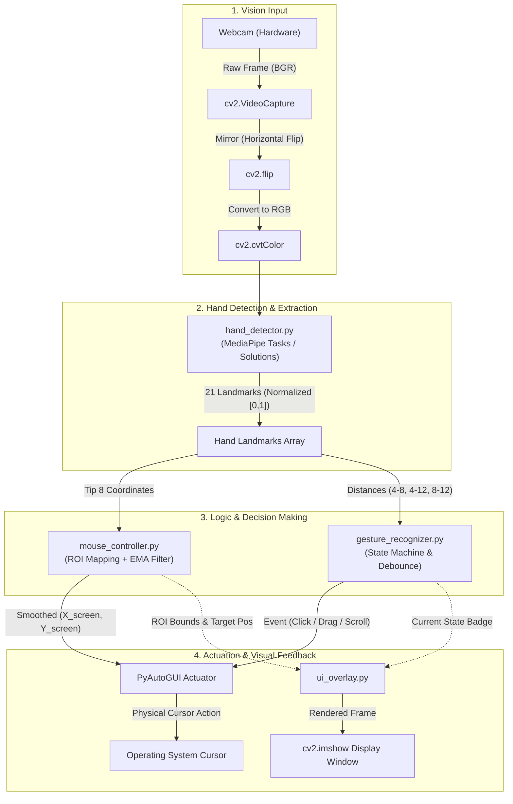

# Virtual Mouse: System Architecture, SOLID Principles & Library Guide

This document explains the software engineering foundations, design patterns, SOLID principles, library mental models, and modular architecture used to build the **01 - Virtual Mouse** project.

---

## 1. OOP vs. SOLID: The Engineering Paradigm

### The Difference
* **OOP (Object-Oriented Programming)** is a **programming paradigm**. It gives you mechanisms: classes, objects, encapsulation, inheritance, and polymorphism.
* **SOLID** is a set of **architectural principles**. It guides *how* to organize classes and methods so your system remains maintainable, scalable, testable, and loosely coupled.

> **Why this matters:** A beginner tutorial often writes 200 lines of procedural code in a single file with 15 global variables. It works once, but as soon as you want to change the gesture engine, switch to a faster Windows API, or write automated unit tests, the entire application breaks. SOLID prevents code from turning into "spaghetti code".

---

## 2. SOLID Principles Mapped Directly to Virtual Mouse

```
+─────────────────────────────────────────────────────────────────────────────────────────+
|                                SOLID IN VIRTUAL MOUSE                                   |
+───+──────────────────────────────+──────────────────────────────────────────────────────+
| S | Single Responsibility (SRP)  | Each class has exactly ONE reason to change.         |
| O | Open / Closed (OCP)          | Add new gestures without altering existing detectors.|
| L | Liskov Substitution (LSP)    | Swap Tasks API and Solutions API transparently.      |
| I | Interface Segregation (ISP)  | Expose only minimal mouse actions (5 of 60 methods). |
| D | Dependency Inversion (DIP)   | Main loop depends on abstract interfaces, not tools. |
+───+──────────────────────────────+──────────────────────────────────────────────────────+
```

### 1. S — Single Responsibility Principle (SRP)
*Every class should have one, and only one, reason to change.*

* **`HandDetector`**: Responsible *only* for consuming an image frame and outputting 21 hand landmarks. It has no idea what a mouse, screen resolution, or click is.
* **`MouseController`**: Responsible *only* for mapping coordinates, smoothing jitter, and invoking OS cursor movement. It has no idea what a webcam or MediaPipe is.
* **`GestureRecognizer`**: Responsible *only* for interpreting geometric relationships (distances, angles) between landmark points to classify user intent (`MOVE`, `LEFT_CLICK`, `RIGHT_CLICK`, `DRAG`, `SCROLL`).
* **`UIOverlay`**: Responsible *only* for rendering visual feedback (bounding boxes, tracking dots, mode banners, FPS) on an OpenCV image frame.
* **`Main`**: Responsible *only* for orchestrating the frame-by-frame loop and managing application lifecycle (start, run, cleanup).

### 2. O — Open / Closed Principle (OCP)
*Software entities should be open for extension, but closed for modification.*

* **In Practice:** If you want to introduce a brand-new gesture (e.g., **"Peace Sign to Take Screenshot"** or **"Three Fingers Up to Volume Up"**):
  - You do **not** touch `hand_detector.py`, `mouse_controller.py`, or `config.py`.
  - You simply add a new gesture rule or strategy class to `gesture_recognizer.py`. The rest of the system remains untouched and un-broken.

### 3. L — Liskov Substitution Principle (LSP)
*Objects of a superclass should be replaceable with objects of its subclasses without breaking application correctness.*

* **In Practice:**
  ```python
  class BaseHandDetector(ABC):
      @abstractmethod
      def find_landmarks(self, frame: np.ndarray) -> Optional[HandLandmarks]:
          pass

  class MediaPipeTasksDetector(BaseHandDetector): ...
  class MediaPipeSolutionsDetector(BaseHandDetector): ...
  ```
  Both detectors implement the exact same contract. If `MediaPipeTasksDetector` cannot load the binary model bundle on a specific OS, `MediaPipeSolutionsDetector` substitutes it seamlessly without the main application knowing the difference.

### 4. I — Interface Segregation Principle (ISP)
*Clients should not be forced to depend upon interfaces that they do not use.*

* **In Practice:** The `pyautogui` package has dozens of unrelated methods: `screenshot()`, `typewrite()`, `alert()`, `pixelMatchesColor()`, `keyDown()`.
* Rather than scattering raw `pyautogui` calls across the codebase, we define a lean interface inside `MouseController` containing only the 5 primitives our project actually needs:
  1. `move(x, y)`
  2. `click(button)`
  3. `double_click()`
  4. `drag(x, y)`
  5. `scroll(delta)`

### 5. D — Dependency Inversion Principle (DIP)
*High-level modules should not depend on low-level modules. Both should depend on abstractions.*

* **In Practice:** The high-level application orchestrator (`main.py`) does not instantiate hardcoded third-party libraries directly inside its core logic.
* It accepts an instance of `BaseHandDetector` and `BaseMouseController`. If tomorrow you want to replace PyAutoGUI with the ultra-low-latency Windows C-API (`ctypes.windll.user32.SetCursorPos`), you write a `WindowsMouseController` and inject it without modifying `main.py`.

---

## 3. Library Mental Models (The 10% Rule)

You do **not** need to read hundreds of pages of documentation. In real-world software engineering, you master the **mental model** and the specific subset of functions required for the task.

| Library | Mental Model | Exactly What We Use in This Project |
| :--- | :--- | :--- |
| **OpenCV (`cv2`)** | **"The Camera & Canvas"**<br>Treats images as 2D/3D NumPy arrays (matrices of color pixels). Reads frames from the webcam, mirrors them, and draws overlays. | • `cv2.VideoCapture(0)`: Open camera stream<br>• `cap.read()`: Read next frame<br>• `cv2.flip(frame, 1)`: Mirror image horizontally<br>• `cv2.circle()`, `cv2.rectangle()`, `cv2.putText()`: Draw HUD<br>• `cv2.imshow()`, `cv2.waitKey()`: Render display window |
| **MediaPipe** | **"The Hand Geometry Engine"**<br>A pre-trained deep learning vision pipeline that detects hands and extracts 21 key joint positions in 3D space $(x, y, z)$. | • `HandLandmarker` / `mp.solutions.hands`: Model inference<br>• Outputs normalized coordinates $[0.0, 1.0]$ for 21 landmarks<br>• Key target: Landmark 8 (`INDEX_FINGER_TIP`) |
| **NumPy (`numpy`)** | **"The Vector Math Accelerator"**<br>C-optimized numerical library for fast array calculations and spatial geometry. | • `np.interp()`: Linear interpolation (maps camera box to monitor resolution)<br>• `np.linalg.norm()` or Euclidean distance: Computes distance between finger tips |
| **PyAutoGUI** | **"The Robot Hand"**<br>Automates operating system mouse pointer events and hardware interactions. | • `pyautogui.size()`: Reads desktop width and height<br>• `pyautogui.moveTo(x, y)`: Repositions cursor<br>• `pyautogui.click()`, `pyautogui.rightClick()`, `pyautogui.scroll()` |

---

## 4. End-to-End System Architecture

### Data Flow Diagram



---

## 5. Mathematical Foundations

### A. Coordinate Mapping (Active ROI with Margin)
Users cannot comfortably push their physical hands out to the edges of the webcam frame to reach the corners of their computer monitor. We define an **Active Region of Interest (ROI)** with padding margins $M$:

$$\text{Screen}_X = \text{interp}\left(\text{Finger}_X, [M, W_{frame} - M], [0, W_{screen}]\right)$$
$$\text{Screen}_Y = \text{interp}\left(\text{Finger}_Y, [M, H_{frame} - M], [0, H_{screen}]\right)$$

Any position outside the margin is clamped to the screen boundaries $[0, W_{screen}]$ and $[0, H_{screen}]$.

### B. Jitter Reduction (Exponential Moving Average - EMA)
Human fingers naturally experience micro-tremors, and webcam sensors contain temporal noise. If you directly map raw pixel coordinates to the mouse, the cursor shakes violently.

The EMA filter smooths movement:
$$P_{\text{smooth}}(t) = \alpha \cdot P_{\text{target}}(t) + (1 - \alpha) \cdot P_{\text{smooth}}(t - 1)$$

* $\alpha = 1.0$: No smoothing (raw, responsive, but jittery).
* $\alpha \approx 0.3 - 0.5$: Optimal balance (glides smoothly with imperceptible latency).
* $\alpha \to 0.0$: Heavy smoothing (laggy, sluggish cursor).

### C. Hand-Scale Invariant Distance Metric
Instead of hardcoding a fixed pixel distance (e.g. "30 pixels") for a pinch click—which breaks if your hand moves closer to or further from the camera—we normalize the pinch distance using the baseline length between **Landmark 0 (Wrist)** and **Landmark 5 (Index MCP)**:

$$\text{PinchRatio} = \frac{\|\mathbf{P}_4 - \mathbf{P}_8\|}{\|\mathbf{P}_0 - \mathbf{P}_5\|}$$

When $\text{PinchRatio} < \text{threshold}$, a click triggers reliably regardless of camera distance.

---

## 6. Modular File Layout & Responsibilities

```
01-virtual-mouse/
│
├── config.py
│   └── Holds all configuration constants: resolutions, ROI margins, smoothing factors,
│       thresholds, and debug flags. Single source of truth.
│
├── hand_detector.py
│   └── BaseHandDetector abstract class and MediaPipe implementations.
│       Converts raw frames into standardized landmark collections.
│
├── mouse_controller.py
│   └── Responsible for screen size detection, ROI linear interpolation,
│       EMA motion smoothing, coordinate boundary clamping, and PyAutoGUI calls.
│
├── gesture_recognizer.py
│   └── Analyzes landmark geometry, maintains state timers (click debounce,
│       drag hold detection, scroll velocity), and yields discrete gesture events.
│
├── ui_overlay.py
│   └── Renders all visual cues on the OpenCV canvas: active ROI rectangle,
│       colored fingertip tracking circles, mode badges, and FPS counter.
│
├── main.py
│   └── Orchestrates the loop: initializes camera, calls the detector, feeds coordinates
│       to the controller and recognizer, renders the HUD, and catches exit keys ('q').
│
├── requirements.txt
│   └── Lists project dependencies: opencv-python, mediapipe, pyautogui, numpy.
│
├── IMPLEMENTATION_PLAN.md
│   └── Step-by-step roadmap and technical milestone tracking.
│
└── diagram.png
    └── MediaPipe 21 Hand Landmarks topological reference diagram.
```

---

## 7. MediaPipe 21-Landmark Topological Reference

Based on [diagram.png](file:///d:/6%20Months%20-%20SDE2%20level/python-ai-vision/01-virtual-mouse/diagram.png):

```
       [8]  Index Tip
        |
       [7]  Index DIP
        |
       [6]  Index PIP
        |
[4]    [5]  Index MCP ─── [9] ─── [13] ─── [17]
Thumb   \                  |        |        |
Tip      \                 |        |        |
          \                |        |        |
          [3]              |        |        |
           |               |        |        |
          [2]              |        |        |
           |               |        |        |
          [1]              |        |        |
            \              |        |        /
             \─────────── [0] ──────────────/
                         Wrist
```

* **Landmark 8 (`INDEX_FINGER_TIP`)**: Tracks primary cursor movement.
* **Landmark 4 (`THUMB_TIP`)**: Serves as the anchor for pinch clicks.
* **Landmark 12 (`MIDDLE_FINGER_TIP`)**: Triggers right-click when pinched with thumb, or triggers scrolling when paired with landmark 8.
* **Landmark 0 (`WRIST`) & 5 (`INDEX_MCP`)**: Reference baseline for hand scale and distance calculation.
